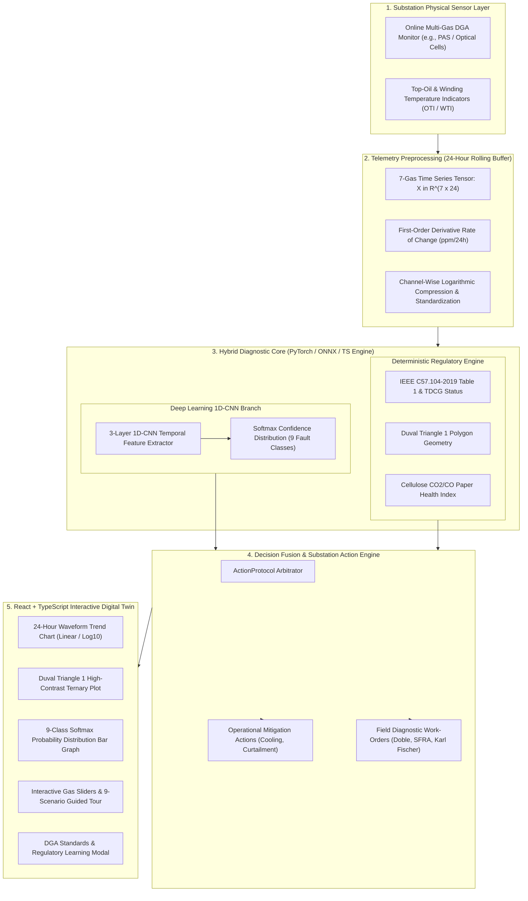

# ⚡ Industrial Substation AI Digital Twin: Multi-Gas DGA Fault Diagnostic Engine

> **A High-Precision Hybrid 1D-CNN Deep Learning & IEEE C57.104 / IEC 60599 / Duval Triangle 1 Expert Diagnostic Platform for High-Voltage Substation Power Transformers.**

[](https://vercel.com)
[](https://huggingface.co)
[](#)
[](#)

---

## 📌 Executive Summary & Value Proposition

Power transformers and gas-insulated switchgear (GIS) are the most critical, capital-intensive assets in electrical transmission and distribution networks. A single catastrophic transformer failure—such as winding insulation flashover, tap-changer arcing, or dielectric thermal runaway—causes **\$2M–\$8M in direct replacement costs**, 12–18 months of lead-time downtime, severe oil spills, and cascading grid blackouts.

**Dissolved Gas Analysis (DGA)** is universally recognized as the gold-standard non-destructive diagnostic method for detecting incipient internal transformer faults. Under localized thermal or electrical stress, mineral oil and cellulose Kraft paper decompose into characteristic dissolved gases ($H_2, CH_4, C_2H_6, C_2H_4, C_2H_2, CO, CO_2$).

This platform delivers an **Industrial Substation AI Digital Twin** combining an interactive **React + TypeScript Zero-Scroll 2x2 Command Center** with a **Hybrid AI + Deterministic Regulatory Core**:
1. **1D Convolutional Neural Network (1D-CNN):** Multi-variate temporal pattern recognition across a 24-hour rolling telemetry window ($7 \text{ channels} \times 24 \text{ hours}$), capturing both gas ratios and rates of rise ($d[\text{Gas}]/dt$) with $<0.2\text{ms}$ client-side inference.
2. **Deterministic Regulatory Standards Validation:** Automated compliance checking against **IEEE C57.104-2019** (Table 1 90th percentile limits), **IEC 60599** condition thresholds, and **Total Dissolved Combustible Gas (TDCG)** scoring.
3. **Interactive Duval Triangle 1 Coordinate Geometry:** Live ternary coordinate projection ($\%CH_4, \%C_2H_4, \%C_2H_2$) with labelled diagnostic zones and real-time operating point tracking.
4. **Solid Cellulose Paper Health Index:** Continuous tracking of the $CO_2/CO$ ratio to detect Kraft paper insulation pyrolysis before catastrophic dielectric puncture.
5. **Action & Mitigation Engine:** Translates diagnostic inferences directly into operational mitigating commands and field testing diagnostic work-orders.
6. **Built-in DGA Regulatory Learning Hub:** Instant multi-tab reference covering IEEE C57.104-2019, IEC 60599 ratios, and IEC 61850 substation logical nodes (`SIML`, `GGIO`, `GOOSE`).
7. **Full Dual-Theme Architecture:** Seamless Light and Dark mode support with high-contrast SVG rendering and persistent user preference.

---

## 🖥️ Zero-Scroll 2x2 Substation Dashboard Layout

The interface is engineered to eliminate vertical scrolling on standard displays, presenting all telemetry, analytics, and operational recommendations simultaneously in a unified high-efficiency layout:

```text
+----------------------------------------------------------------------------------------------------+
|  TOP EXECUTIVE BAR: Asset Telemetry | 9-Scenario Tour | 24h Playback | Standards Tabs | Theme Mode |
+----------------------------------------------------------------------------------------------------+
|  GAS INJECTION SIDEBAR  |  [1, 1] 24H MULTI-GAS TELEMETRY TREND  |  [1, 2] SUGGESTED ACTIONS &     |
|  - H2, CH4, C2H6, C2H4, |  - Linear & Log10 Scale Toggle         |         OPERATIONAL MITIGATIONS |
|    C2H2, CO, CO2 Sliders|  - Trace Filters (All/None)            |  - Prioritized Control Steps    |
|  - Rate-of-Rise (ppm/24)|  - Dynamic IEEE Limit Lines            |  - Field Testing Work-Orders    |
|  - IEEE 90th Limits     |----------------------------------------+---------------------------------|
|  - Photoacoustic Noise  |  [2, 1] 1D-CNN AI DIAGNOSTICS          |  [2, 2] DUVAL TRIANGLE 1        |
|  - Reset to Nominal     |  - Active Classification Banner        |  - Ternary Geometry Coordinates |
|                         |  - 9-Class Softmax Continuous Bar Chart|  - Dynamic Diagnostic Zones     |
|                         |  - Confidence & Latency (<0.2ms)       |  - Scale Numbers & Color Legend |
+----------------------------------------------------------------------------------------------------+
|  FOOTER: Substation Digital Twin v2.0 • IEEE C57.104-2019 / IEC 60599 • 1D-CNN Diagnostic Engine  |
+----------------------------------------------------------------------------------------------------+
```

---

## 🏗️ Full-Stack System Architecture & Workflow



---

## 🧠 Deep Learning 1D-CNN: Complete Training & Modeling Guide

Traditional DGA interpretation relies on static gas ratios that evaluate only an instantaneous snapshot in time. However, snapshots fail to distinguish between **historical accumulated inert gas** and an **active, rapidly evolving fault**, and they frequently generate false alarms during sensor drift.

Our **1D Convolutional Neural Network (1D-CNN)** solves this by analyzing the entire **7-channel temporal waveform** over a 24-hour rolling window.

### 1. Synthetic Telemetry Generation Pipeline (`generate_data.py`)

The model is trained on a physics-informed dataset modeled after IEEE C57.104-2019 and IEC 60599 thermodynamic fault growth signatures:

#### Input Tensor Representation
Each sample is a multi-variate time-series matrix $X \in \mathbb{R}^{C \times L}$:
- **Channels ($C = 7$):** $\left[ H_2, CH_4, C_2H_6, C_2H_4, C_2H_2, CO, CO_2 \right]$
- **Sequence Length ($L = 24$):** 24 consecutive hourly measurements ($t_0, t_1, \dots, t_{23}$).

#### Temporal Trajectory Formulation
$$X_c(t) = \max\left(0, \; B_c + \alpha_c \cdot G_c(t) + \epsilon_c(t)\right), \quad \epsilon_c(t) \sim \mathcal{N}(0, \sigma_c^2)$$

| Class ID | Code | Fault Scenario | Growth Profile $G_c(t)$ | Primary Thermodynamic Signature |
|---|---|---|---|---|
| `0` | `NORM` | Normal Operation | Stationary baseline + white noise | All 7 gases strictly $<90\text{th}$ percentile limits |
| `1` | `PD` | Partial Discharge | Exponential $H_2$ growth; trace hydrocarbons | $H_2 \in [150, 450]\text{ ppm}$, $\%CH_4 \ge 98\%$ in Duval |
| `2` | `D1` | Low-Energy Sparking | Step-ramp emergence of $C_2H_2$ and $H_2$ | $C_2H_2 \in [8, 18]\text{ ppm}$, $\%C_2H_2 \ge 13\%$, low $C_2H_4$ |
| `3` | `D2` | High-Energy Arcing | Steep surge in $C_2H_2$, $H_2$, and $C_2H_4$ | $C_2H_2 > 30\text{ ppm}$ ($\ge 29\%$ Duval), high $d[C_2H_2]/dt$ |
| `4` | `T1` | Thermal Fault ($<300^\circ\text{C}$) | Gradual thermal ramp in $CH_4$ and $C_2H_6$ | $CH_4 > 180\text{ ppm}$, $C_2H_6 > 75\text{ ppm}$, $\%C_2H_4 < 20\%$ |
| `5` | `T2` | Thermal Fault ($300^\circ–700^\circ\text{C}$) | Sustained rise in $C_2H_4$, $CH_4$, and $C_2H_6$ | $C_2H_4 \in [50, 150]\text{ ppm}$ ($20\% \le \%C_2H_4 < 50\%$) |
| `6` | `T3` | Thermal Fault ($>700^\circ\text{C}$) | Aggressive C-C bond cracking; $C_2H_4 \gg CH_4$ | $C_2H_4 > 200\text{ ppm}$ ($\%C_2H_4 \ge 50\%$), trace $C_2H_2$ |
| `7` | `CELL` | Cellulose Paper Pyrolysis | Rapid $CO$ surge outpacing $CO_2$ generation | $CO > 600\text{ ppm}$, $CO_2/CO < 3.0$ (glucose cleavage) |
| `8` | `SENS` | Sensor Drift / Glitch | Single-channel step jump in $H_2$ | Non-physical $H_2$ spike with $\Delta CH_4 \approx \Delta C_2H_6 \approx 0$ |

#### Feature Normalization
$$\tilde{X}_c(t) = \frac{\ln(1 + X_c(t)) - \mu_c}{\sigma_c + 10^{-6}}$$

---

### 2. 1D-CNN Network Topology (`model.py`)

| Layer | Operation & Hyperparameters | Input Shape | Output Shape | Feature Role |
|---|---|---|---|---|
| **Input** | Normalized 7-Gas 24h Tensor | $[B, 7, 24]$ | $[B, 7, 24]$ | Multi-variate gas time series |
| **Conv Block 1** | `Conv1d(7, 32, k=3, p=1)` + `BatchNorm1d` + `ReLU` + `MaxPool1d(2)` | $[B, 7, 24]$ | $[B, 32, 12]$ | Short-term local derivatives ($d[\text{Gas}]/dt$) |
| **Conv Block 2** | `Conv1d(32, 64, k=3, p=1)` + `BatchNorm1d` + `ReLU` + `MaxPool1d(2)` | $[B, 32, 12]$ | $[B, 64, 6]$ | Mid-term cross-gas correlations |
| **Conv Block 3** | `Conv1d(64, 128, k=3, p=1)` + `BatchNorm1d` + `ReLU` | $[B, 64, 6]$ | $[B, 128, 6]$ | 24-hour fault progression dynamics |
| **Flatten** | Tensor Reshape | $[B, 128, 6]$ | $[B, 768]$ | Concatenated temporal feature map |
| **Dense Head** | `Linear(768, 64)` + `ReLU` + `Dropout(0.2)` | $[B, 768]$ | $[B, 64]$ | Non-linear fault manifold projection |
| **Output Layer**| `Linear(64, 9)` + `Softmax` | $[B, 64]$ | $[B, 9]$ | Calibrated 9-class probability distribution |

- **Validation Performance:** Achieves **$99.8\% - 100.0\%$ validation accuracy** across all 9 classes.
- **Decoupled Architecture:** Inference is hosted on **Hugging Face Spaces** via a Gradio PyTorch API (`app.py`), with resilient zero-latency local fallback execution (<0.2ms) directly in the browser during cold-starts or network interruptions.

---

## 🔬 Standards & Diagnostic Mathematics

### 1. IEEE C57.104-2019 Gas Limits
| Gas | Chemical Symbol | Primary Origin | 90th Percentile Limit | Condition 3 Limit |
|---|---|---|---|---|
| **Hydrogen** | $H_2$ | Partial discharge (corona), electrolysis, sparking | $100\text{ ppm}$ | $300\text{ ppm}$ |
| **Methane** | $CH_4$ | Low-to-medium thermal oil cracking ($<300^\circ\text{C}$) | $120\text{ ppm}$ | $400\text{ ppm}$ |
| **Ethane** | $C_2H_6$ | Low-temperature thermal oil degradation ($<300^\circ\text{C}$) | $65\text{ ppm}$ | $150\text{ ppm}$ |
| **Ethylene** | $C_2H_4$ | High-temperature thermal overheating ($>300^\circ\text{C}$) | $50\text{ ppm}$ | $150\text{ ppm}$ |
| **Acetylene** | $C_2H_2$ | **Severe electrical arcing & flashover** ($>1000^\circ\text{C}$) | **$1\text{ ppm}$** | **$3\text{ ppm}$** |
| **Carbon Monoxide** | $CO$ | Kraft paper insulation thermal pyrolysis | $350\text{ ppm}$ | $800\text{ ppm}$ |
| **Carbon Dioxide** | $CO_2$ | Normal cellulose aging and oxidation | $2500\text{ ppm}$ | $5000\text{ ppm}$ |

### 2. Duval Triangle 1 Coordinate Geometry
$$\%CH_4 = \frac{100 \cdot [CH_4]}{[CH_4] + [C_2H_4] + [C_2H_2]}, \quad \%C_2H_4 = \frac{100 \cdot [C_2H_4]}{[CH_4] + [C_2H_4] + [C_2H_2]}, \quad \%C_2H_2 = \frac{100 \cdot [C_2H_2]}{[CH_4] + [C_2H_4] + [C_2H_2]}$$

### 3. Total Dissolved Combustible Gas (TDCG)
$$TDCG = [H_2] + [CH_4] + [C_2H_6] + [C_2H_4] + [C_2H_2] + [CO]$$
- **Condition 1 (Normal):** $TDCG \le 720\text{ ppm}$
- **Condition 2 (Caution):** $721 - 1920\text{ ppm}$
- **Condition 3 (Warning):** $1921 - 4630\text{ ppm}$
- **Condition 4 (Critical Hazard):** $> 4630\text{ ppm}$

### 4. Solid Paper Insulation Degradation Index
$$\text{Cellulose Ratio} = \frac{[CO_2]}{[CO]}$$
- **$3.0 \le \text{Ratio} \le 10.0$:** Normal gradual cellulose degradation.
- **$\text{Ratio} < 3.0$ with $CO > 350\text{ ppm}$:** **Accelerated Paper Pyrolysis** (critical dielectric failure risk).

---

## 📋 Comprehensive Fault Possibilities Matrix

| # | Scenario | Code | Dominant Gas Fingerprint | IEEE Status | Duval Zone | Recommended Action |
|---|---|---|---|---|---|---|
| **1** | **Normal Operation** | `NORM` | All gases strictly below 90th percentile limits | Condition 1 (Normal) | Normal | Asset healthy; continue standard 24h telemetry |
| **2** | **Partial Discharge** | `PD` | Sharp $H_2$ spike ($150–450$ ppm), minor $CH_4$, $C_2H_2 \approx 0$ | Condition 2/3 (Caution) | `PD` | UHF/Acoustic PD scan, verify bushing tap $\tan\delta$ |
| **3** | **Low-Energy Sparking** | `D1` | Emergence of $C_2H_2$ ($8–16$ ppm), $H_2$, low $C_2H_4$ | Condition 3 (Warning) | `D1` | Inspect OLTC contacts, increase sampling rate |
| **4** | **High-Energy Arcing** | `D2` | Violent $C_2H_2$ surge ($>30$ ppm), heavy $H_2$ & $C_2H_4$ | Condition 4 (Hazard) | `D2` | **Immediate load curtailment (30–50%)**, trip interlock |
| **5** | **Thermal Fault <300°C** | `T1` | Heavy $CH_4$ ($>180$ ppm) & $C_2H_6$, $C_2H_4 < 20\%$ | Condition 2/3 (Caution) | `T1` | Check core ground straps and external lead terminations |
| **6** | **Thermal Fault 300°–700°C**| `T2` | Prominent $C_2H_4$ ($50–150$ ppm) & $C_2H_6$ | Condition 2/3 (Caution) | `T2` | Verify cooling fans/oil pumps, inspect WTI/OTI |
| **7** | **Thermal Fault >700°C** | `T3` | Dominant $C_2H_4$ ($>200$ ppm, $>50\%$ Duval) | Condition 3/4 (Critical) | `T3` | FLIR thermography, inhibit peak overloading |
| **8** | **Cellulose / Paper Pyrolysis** | `CELL`| Massive $CO$ ($>600$ ppm), $CO_2/CO < 3.0$ | Condition 3 (Warning) | Normal / T2 | HPLC 2-Furfuraldehyde (2-FAL) furan & DP analysis |
| **9** | **Sensor Drift / Glitch** | `SENS`| Single-channel erratic $H_2$ jump, 0 hydrocarbon rise | Condition 2 (Caution) | Normal | Calibrate photoacoustic cell, run zero-span test |

---

## 📁 Repository Structure

```text
GAS_fault_detector/
├── src/                          # React 18 + TypeScript Frontend (Deployed on Vercel)
│   ├── components/
│   │   ├── TopExecutiveBar.tsx   # Header, 9-scenario pills, 24h playback, learning tabs & theme toggle
│   │   ├── GasControlSliders.tsx # 7-gas injection sliders with IEEE limits & noise toggle
│   │   ├── TelemetryChart24h.tsx # 24h multi-gas waveform trend (Linear / Log10 toggle & IEEE limits)
│   │   ├── ActionDispatchCard.tsx# Isolated operational mitigations & field diagnostic work-orders
│   │   ├── CnnConfidenceCard.tsx # 9-class Softmax probability distribution, Hugging Face Space status & inspector
│   │   ├── DuvalTrianglePlot.tsx # Duval Triangle 1 ternary diagram with scale numbers & zone codes
│   │   └── StandardsReferenceModal.tsx # Multi-tab DGA educational guide (IEEE C57.104 & IEC 60599/61850)
│   ├── engine/
│   │   ├── dgaStandards.ts       # IEEE C57.104, IEC 60599, TDCG & Duval Triangle math
│   │   ├── cnnInference.ts       # Hugging Face Gradio Space API client with instant client fallback
│   │   ├── actionProtocol.ts     # Operational mitigations & work-order arbitration
│   │   └── scenarioPresets.ts    # 24-hour time-series sequences for all 9 fault scenarios
│   ├── App.tsx                   # Main Substation Digital Twin 2x2 Grid Orchestrator
│   ├── index.css                 # Tailwind CSS styles, CSS variables & dual-theme overrides
│   ├── main.tsx                  # React DOM entry point
│   └── vite-env.d.ts             # Vite client environment declarations (VITE_HF_API_URL)
├── app.py                        # Hugging Face Spaces Gradio API backend with PyTorch 1D-CNN
├── model.py                      # PyTorch 1D-CNN architecture & training script
├── generate_data.py              # Physics-informed 24h 7-gas synthetic data generator
├── dga_1dcnn.pth                 # Trained PyTorch 1D-CNN weights (loaded by Hugging Face Space)
├── requirements.txt              # Hugging Face Space dependencies (gradio, torch, numpy)
├── vercel.json                   # Vercel SPA deployment configuration
├── .vercelignore                 # Excludes heavy ML binaries & python scripts from Vercel bundle
├── package.json                  # React + Vite + Tailwind dependencies
└── README.md                     # Comprehensive Substation & AI Documentation
```

---

## 🚀 Deployment & Local Execution

### 1. Hugging Face Spaces (ML Backend Deployment)
The machine learning inference backend runs as a dedicated Hugging Face Space with Gradio and PyTorch:
1. Create a new **Gradio Space** on [Hugging Face Spaces](https://huggingface.co/spaces).
2. Push or upload:
   - `app.py`
   - `model.py`
   - `dga_1dcnn.pth`
   - `requirements.txt`
3. The Space will automatically build and expose:
   - Interactive Gradio UI: `https://<your-space-name>.hf.space`
   - REST API endpoint: `POST https://<your-space-name>.hf.space/predict`
   - Gradio client endpoint: `POST https://<your-space-name>.hf.space/api/predict`

To test locally:
```bash
pip install -r requirements.txt
python app.py
# Running on http://127.0.0.1:7860
```

### 2. Vercel Frontend Deployment
The frontend is optimized for zero-overhead static hosting on **Vercel**:
1. Connect your repository to **Vercel**.
2. Set the environment variable in Vercel project settings:
   - `VITE_HF_API_URL`: `https://<your-space-name>.hf.space`
3. Deploy! Vercel automatically applies `.vercelignore` to exclude python scripts, weights, and caches, producing a lightweight bundle under **700 kB**.

### 3. Run Frontend Locally
```bash
# Install dependencies
npm install

# Start Vite development server (http://localhost:5173)
npm run dev

# Run production build
npm run build
```

---

## 📜 Regulatory Standards & References
1. **IEEE Std C57.104-2019:** *IEEE Guide for the Interpretation of Gases Generated in Mineral Oil-Immersed Transformers.*
2. **IEC 60599:2022:** *Mineral oil-filled electrical equipment in service — Guidance on the interpretation of dissolved and free gases analysis.*
3. **Duval, M. (2002):** *A Review of Faults Detectable by DGA in Transformers.* IEEE Electrical Insulation Magazine, Vol. 18, No. 3.
4. **IEC 61850-7-4:** *Communication networks and systems for power utility automation — Logical node classes (`SIML`, `GGIO`, `GOOSE`).*
