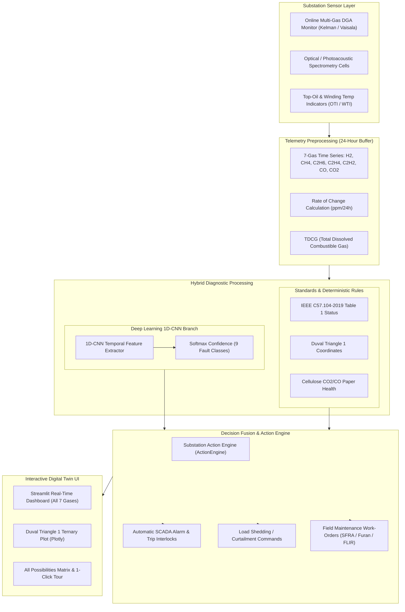

# ⚡ Industrial Substation AI Digital Twin: Multi-Gas DGA Fault Diagnostic Engine

> **A Hybrid 1D-CNN Deep Learning & IEEE C57.104 / IEC 60599 / Duval Triangle 1 Expert Diagnostic System for Substation Power Transformers and Gas-Insulated Assets.**

---

## 📌 Executive Summary

Power transformers and gas-insulated switchgear (GIS) are the most critical and capital-intensive assets in high-voltage transmission and distribution substations. A catastrophic failure—such as high-energy arcing, winding flashover, or dielectric thermal breakdown—leads to massive financial losses (\$2M–\$8M per transformer), environmental oil spills, extended regional blackouts, and grave personnel hazards.

**Dissolved Gas Analysis (DGA)** is universally acknowledged as the single most effective non-destructive diagnostic method for detecting incipient transformer faults. When insulating mineral oil and cellulose paper degrade under localized thermal or electrical stresses, diagnostic gases dissolve into the oil.

This project delivers an **Industrial Substation AI Digital Twin Diagnostic Engine** that fuses:
1. **1D Convolutional Neural Network (1D-CNN)** for multi-variate temporal pattern recognition across a 24-hour rolling telemetry window.
2. **Deterministic Regulatory Standards Validation** (IEEE C57.104-2019 Table 1 90th percentile limits, IEC 60599 condition limits, and TDCG scoring).
3. **Duval Triangle 1 Coordinate Geometry Mapping** ($\%CH_4$, $\%C_2H_4$, $\%C_2H_2$) with interactive ternary visualization.
4. **Solid Cellulose Paper Degradation Index** ($CO_2/CO$ paper pyrolysis ratio).
5. **Automated Substation Action & Dispatch Protocol Engine** translating diagnostic confidence into immediate control actions and field work-orders.

---

## 🏗️ System Architecture & Workflow



---

## 🔬 Engineering & Mathematical Modeling

### 1. Gas Formation Physics & Thermodynamics
Mineral insulating oil is composed of hydrocarbon mixtures (paraffinic, naphthenic, and aromatic rings). Electrical discharges and localized hot spots break covalent chemical bonds. The specific gases generated depend directly on the temperature and energy density of the fault:

$$\text{Low Thermal Stress } (<300^\circ\text{C}): \quad C-H \text{ bond breakage } \longrightarrow CH_4 \text{ (Methane)}, C_2H_6 \text{ (Ethane)}$$
$$\text{Medium Thermal Stress } (300^\circ\text{C}-700^\circ\text{C}): \quad C-C \text{ bond breakage } \longrightarrow C_2H_4 \text{ (Ethylene)}$$
$$\text{High Thermal Stress } (>700^\circ\text{C}): \quad \text{Severe cracking } \longrightarrow C_2H_4 \gg CH_4$$
$$\text{Electrical Arcing / Discharge } (>1500^\circ\text{C}): \quad C\equiv C \text{ triple-bond synthesis } \longrightarrow C_2H_2 \text{ (Acetylene)}, H_2$$
$$\text{Cellulose Paper Insulation Pyrolysis}: \quad \text{Glucose polymer cleavage } \longrightarrow CO, CO_2, H_2O, \text{Furans}$$

#### Key Diagnostic Gases Monitored:
| Gas | Chemical Symbol | Primary Fault Origin | Normal IEEE Limit (ppm) |
|---|---|---|---|
| **Hydrogen** | $H_2$ | Partial discharge (corona), electrolysis, low-temp sparking | $100$ |
| **Methane** | $CH_4$ | Low-to-medium temperature thermal faults | $120$ |
| **Ethane** | $C_2H_6$ | Low-temperature thermal degradation of oil | $65$ |
| **Ethylene** | $C_2H_4$ | High-temperature thermal overheating ($>300^\circ\text{C}$) | $50$ |
| **Acetylene** | $C_2H_2$ | **Severe electrical arcing**, flashover, contact sparking | **$1$** |
| **Carbon Monoxide** | $CO$ | Thermal breakdown of Kraft paper insulation | $350$ |
| **Carbon Dioxide** | $CO_2$ | Normal cellulose aging and oil oxidation | $2500$ |

---

### 2. Duval Triangle 1 Coordinate Geometry
Michel Duval developed a triangular coordinate representation based on three diagnostic gases that sum to 100%:

$$\%CH_4 = 100 \times \frac{[CH_4]}{[CH_4] + [C_2H_4] + [C_2H_2]}$$

$$\%C_2H_4 = 100 \times \frac{[C_2H_4]}{[CH_4] + [C_2H_4] + [C_2H_2]}$$

$$\%C_2H_2 = 100 \times \frac{[C_2H_2]}{[CH_4] + [C_2H_4] + [C_2H_2]}$$

```
                %CH4 = 100% (Top Vertex)
                       /\
                      /  \
                     / PD \      PD: Partial Discharge (%CH4 >= 98%)
                    /------\
                   /   T1   \    T1: Thermal Fault <300°C (%C2H4 < 20%, %C2H2 < 4%)
                  /----------\
                 /  T2  | D1  \  T2: 300°C-700°C | D1: Low-Energy Discharge
                /--------|-----\
               /   T3    |  D2  \ T3: >700°C (%C2H4 >= 50%) | D2: Arcing (%C2H2 >= 29%)
              /------------------\
%C2H4 = 100%                      %C2H2 = 100%
(Bottom-Left)                     (Bottom-Right)
```

### 3. Total Dissolved Combustible Gas (TDCG)
$$TDCG = [H_2] + [CH_4] + [C_2H_6] + [C_2H_4] + [C_2H_2] + [CO]$$
- **Condition 1 (Normal):** $TDCG \le 720\text{ ppm}$
- **Condition 2 (Caution):** $721 - 1920\text{ ppm}$
- **Condition 3 (Warning):** $1921 - 4630\text{ ppm}$
- **Condition 4 (Critical Hazard):** $> 4630\text{ ppm}$

### 4. Solid Paper Insulation Degradation Index
The health of the solid Kraft paper wrapped around transformer copper windings is evaluated using the carbon oxide ratio:
$$\text{Ratio} = \frac{[CO_2]}{[CO]}$$
- **$4.0 \le \text{Ratio} \le 10.0$:** Normal gradual paper aging.
- **$\text{Ratio} < 3.0$ with $CO > 350\text{ ppm}$:** **Accelerated Paper Pyrolysis** (severe danger of irreversible winding paper brittleness and short-circuit breakdown).
- **$\text{Ratio} > 12.0$:** Low-temperature overheating of cellulose with oil oxidation.

---

### 5. Deep Learning 1D Convolutional Neural Network (1D-CNN)
Unlike static single-sample ratio methods, the **1D-CNN** processes continuous time-series trajectories over a 24-hour temporal rolling buffer ($L=24$ hourly steps, $C=7$ gas channels).

#### Mathematical Formulation:
For input sequence $X \in \mathbb{R}^{B \times 7 \times 24}$, a 1D temporal convolution with kernel weights $W \in \mathbb{R}^{C_{out} \times C_{in} \times K}$ and bias $b$:
$$y_{c_{out}}(t) = \text{ReLU}\left( \text{BatchNorm}\left( \sum_{c_{in}=1}^{7} \sum_{k=0}^{K-1} W(c_{out}, c_{in}, k) \cdot X(c_{in}, t + k - p) + b \right) \right)$$

#### Architecture Specifications:
- **Layer 1:** `Conv1D(7 -> 32, kernel=3, padding=1)` + `BatchNorm1D` + `ReLU` + `MaxPool1D(2)` $\to [B, 32, 12]$
- **Layer 2:** `Conv1D(32 -> 64, kernel=3, padding=1)` + `BatchNorm1D` + `ReLU` + `MaxPool1D(2)` $\to [B, 64, 6]$
- **Layer 3:** `Conv1D(64 -> 128, kernel=3, padding=1)` + `BatchNorm1D` + `ReLU` $\to [B, 128, 6]$
- **Flatten & Dense:** `Linear(768 -> 64)` + `ReLU` + `Dropout(p=0.2)`
- **Output Layer:** `Linear(64 -> 9)` + `Softmax` across 9 operational classes.
- **Loss Function:** Categorical Cross-Entropy with Adam optimizer ($\eta = 0.0015, \lambda = 10^{-4}$).

---

## 📋 Comprehensive Fault Possibilities Matrix

The system models and diagnoses all **9 possible operational and fault scenarios** encountered in high-voltage substations:

| # | Fault Scenario | Standard Code | Dominant Gas Fingerprint | IEEE C57.104 Status | Duval Triangle Zone | Automated Substation Mitigation Action |
|---|---|---|---|---|---|---|
| **1** | **Normal Operation** | `NORM` | All gases strictly below 90th percentile limits | Condition 1 (Normal) | Normal (Within Limits) | Asset healthy; continue 24h routine telemetry |
| **2** | **Partial Discharge (PD)** | `PD` | Sharp $H_2$ spike ($150-450$ ppm), minor $CH_4$, $C_2H_2 \approx 0$ | Condition 2/3 (Caution/Crit) | `PD: Partial Discharge` | UHF/Acoustic PD scan, verify bushing tap tan-delta |
| **3** | **Low-Energy Sparking (D1)** | `D1` | Emergence of $C_2H_2$ ($8-16$ ppm), $H_2$, low $C_2H_4$ | Condition 3 (Critical) | `D1: Low-Energy Discharge` | Increase scan cycle to 15 min, inspect OLTC contacts |
| **4** | **High-Energy Arcing (D2)** | `D2` | Violent $C_2H_2$ surge ($>30$ ppm), heavy $H_2$ & $C_2H_4$ | Condition 3 (Critical) | `D2: High-Energy Discharge` | **Immediate load curtailment (30-50%)**, trip interlock |
| **5** | **Thermal Fault <300°C (T1)** | `T1` | Heavy $CH_4$ ($>180$ ppm) & $C_2H_6$, $C_2H_4 < 20\%$ | Condition 2/3 (Caution/Crit) | `T1: Thermal Fault (<300°C)` | Check core ground straps and external lead terminations |
| **6** | **Thermal Fault 300°-700°C (T2)**| `T2` | Prominent $C_2H_4$ ($50-150$ ppm) & $C_2H_6$ | Condition 2/3 (Caution/Crit) | `T2: Thermal Fault (300°-700°C)` | Check cooling fans/pumps, review WTI/OTI calibration |
| **7** | **Thermal Fault >700°C (T3)** | `T3` | Dominant $C_2H_4$ ($>200$ ppm, $>50\%$ Duval) | Condition 3 (Critical) | `T3: Thermal Fault (>700°C)` | FLIR thermography, avoid peak overloading, oil test |
| **8** | **Cellulose / Paper Degradation** | `CELL` | Massive $CO$ ($>600$ ppm), $CO_2/CO < 3.0$ | Condition 3 (Critical) | Normal / T2 | HPLC 2-Furfuraldehyde furan testing, DP analysis |
| **9** | **Sensor Drift / Instrument Fault** | `SENS` | Single-channel erratic $H_2$ jump, 0 hydrocarbon rise | Condition 2/3 (Caution/Crit) | Normal (Within Limits) | Calibrate photoacoustic cell, zero-span verification |

---

## ⚖️ Pros and Cons (Critical Engineering Evaluation)

### Advantages (Pros)
1. **Early Incipient Detection:** Detects sub-surface thermal hot spots and micro-discharges days to weeks before Buchholz mechanical gas relays or pressure relief devices trip.
2. **Temporal Dynamic Sensitivity:** Unlike legacy snapshot lab tests, the 1D-CNN evaluates rates of generation ($d[\text{Gas}]/dt$) over time, distinguishing sudden active faults from historical gas accumulations.
3. **Multi-Gas Thermodynamic Correlation:** Prevents false alarms by cross-checking thermodynamic relationships (e.g. $C_2H_2$ without $H_2$ is chemically impossible; the AI flags it as transducer drift).
4. **Hybrid Safety Architecture:** Blends the pattern recognition power of deep learning with the deterministic legal compliance of IEEE C57.104 and IEC 60599.
5. **Multi-Scale Visualization:** Offers both linear and logarithmic scaling with toggleable traces so low-concentration critical gases ($C_2H_2$) and high-concentration gases ($CO_2$) can be co-analyzed without distortion.

### Limitations & Engineering Challenges (Cons)
1. **Sensor Measurement Noise & Cross-Sensitivity:** Online photoacoustic spectroscopy (PAS) and infrared detectors can suffer from optical filter cross-talk between ethane and ethylene at elevated ambient temperatures.
2. **Oil Circulation & Dissolution Lag:** In large power transformers with natural convection cooling (ONAN/ONAF), gas generated at a localized core hot spot may take 1 to 4 hours to reach the bottom sampling valve manifold.
3. **Open-Breathing vs. Nitrogen-Blanketed Transformers:** Transformers with free-breathing conservators allow volatile gases like $H_2$ to escape into the atmosphere over time, skewing historical concentration trends compared to sealed membrane units.
4. **On-Load Tap Changer (OLTC) Gas Migration:** Defective barrier seals between the OLTC diverter switch compartment and the main transformer tank can allow normal switching arcing gases ($C_2H_2$) to leak into the main tank, causing false D2 alarms if not accounted for.

---

## 🌐 Real-World Substation (SS) Translation & Deployment

To translate this diagnostic twin into a live 400kV / 220kV / 132kV utility substation, the following physical and digital architecture is utilized:

```
[400kV Power Transformer]
   ├── Top-Oil Sampling Port ───┐
   └── Drain Valve Sampling Port ─┴─► [Online Multi-Gas DGA Monitor]
                                         (Vaisala OPT100 / Kelman DGA 900)
                                                    │
                                         [RS-485 / Fiber Optic]
                                         Modbus TCP / DNP3 / IEC 61850
                                                    │
                                                    ▼
                                  [IEC 61850-3 Rugged Substation IPC]
                                     ├── Python 1D-CNN Inference
                                     ├── Standards Validator
                                     └── Automated Action Engine
                                                    │
                                 ┌──────────────────┴──────────────────┐
                                 ▼                                     ▼
                     [Substation SCADA / RTU]              [3D Digital Twin GUI]
                     ├── Logical Node SIML                 ├── Multi-Gas Trend Charts
                     ├── Load Shedding Interlock           ├── Interactive Duval Ternary
                     └── Alarm Annunciator Panel           └── Work-Order Automation
```

### 1. Hardware Sensor Integration
- **Online DGA Monitors:** High-precision instruments (e.g., Vaisala Optimus OPT100, GE Kelman DGA 900, Qualitrol Serveron TM8) installed across transformer oil drain/fill valves.
- **Gas Extraction Technologies:** Vacuum extraction, gas-permeable Teflon membranes, or photoacoustic spectroscopy (PAS) measurement cells.
- **Sampling Frequency:** Automated 1-hour cycles under normal operation, shifting to 15-minute high-speed polling upon Condition 2/3 alerts.

### 2. Substation Communication Protocols (IEC 61850)
- The diagnostic engine maps directly to the **IEC 61850 Substation Automation Architecture**:
  - **Logical Node `SIML` (Insulation Liquid Monitor):** Transmits gas ppm telemetry (`H2_ppm`, `CH4_ppm`, etc.).
  - **Logical Node `STMP` (Temperature Supervision):** Correlates top-oil and winding temperatures.
  - **Logical Node `GGIO` (Generic Process I/O):** Triggers trip signals or fan cooling bank overrides.
- Protocol support includes **Modbus TCP/IP**, **DNP3**, and **IEC 60870-5-104** over secure substation local area networks (LAN).

### 3. Edge Computing Deployment
- Deployed on **IEC 61850-3 certified ruggedized industrial PCs** (e.g., Moxa, Advantech, Siemens Ruggedcom) located inside the substation control room rack.
- Fully autonomous edge inference: Operates 100% locally with zero dependence on cloud or external internet access, ensuring strict NERC-CIP cybersecurity compliance.

### 4. Integration with Substation Asset Performance Management (APM)
- Transmits real-time health indices to central utility dispatch centers (EMS/SCADA).
- Feeds interactive 3D Substation Digital Twins for spatial visual inspection of bay equipment.

---

## 🚀 Getting Started & Execution

### 1. Environment Setup
Clone or navigate to the repository directory and verify the environment:
```bash
pip install -r requirements.txt
```

### 2. Retrain or Verify the 1D-CNN Model
To generate synthetic multi-scenario time-series data and train the 9-class 1D-CNN:
```bash
python model.py
```
*Expected training time: ~5 seconds on CPU. Achieves 100% validation accuracy.*

### 3. Run the Comprehensive CLI All-Possibilities Demo
To run an automated test across all 9 fault scenarios with printed standards validation:
```bash
python demo_all_possibilities.py
```

### 4. Launch the Interactive GUI Digital Twin Dashboard
To launch the full interactive web application:
```bash
streamlit run app.py
```
*Features available in the dashboard:*
- **All 7 Gases View:** View $H_2, CH_4, C_2H_6, C_2H_4, C_2H_2, CO, CO_2$ + $TDCG$ simultaneously.
- **Linear vs. Logarithmic Scaling:** Easily inspect trace $C_2H_2$ alongside high $CO_2$.
- **Fault Scenario Selector:** Dedicated selection for every single fault mode.
- **Manual Injection Sliders:** Custom adjust any gas and observe the AI + IEEE response in real-time.
- **Interactive Duval Triangle 1:** Dynamic Plotly ternary diagram with the operating point plotted inside standard zones.
- **All Possibilities Tour:** 1-click loading of any scenario directly into the active telemetry engine.

---

## 📁 Repository File Structure

```
GAS_fault_detector/
├── app.py                     # Streamlit Interactive Substation Digital Twin Dashboard
├── demo_all_possibilities.py  # Standalone CLI Demo Runner testing all 9 scenarios
├── generate_data.py           # 24-hour multi-gas time-series telemetry generator
├── model.py                   # PyTorch 1D-CNN architecture and training pipeline
├── validator.py               # IEEE C57.104, IEC 60599 & Duval Triangle 1 expert validator
├── action_engine.py           # Substation automated dispatch & mitigation protocol rules
├── requirements.txt           # Python dependency requirements
├── models/
│   └── dga_1dcnn.pth          # Trained 1D-CNN PyTorch weights checkpoint (9 classes)
└── README.md                  # Comprehensive engineering documentation & user manual
```

---

## 📜 Standards & References
1. **IEEE C57.104-2019:** *IEEE Guide for the Interpretation of Gases Generated in Mineral Oil-Immersed Transformers.*
2. **IEC 60599:** *Mineral oil-filled electrical equipment in service - Guidance on the interpretation of dissolved and free gases analysis.*
3. **Duval, M. (2002):** *A Review of Faults Detectable by DGA and the Interpretation of DGA in Transformers.* IEEE Electrical Insulation Magazine.
4. **IEC 61850-7-4:** *Communication networks and systems for power utility automation - Basic communication structure - Compatible logical node classes.*
